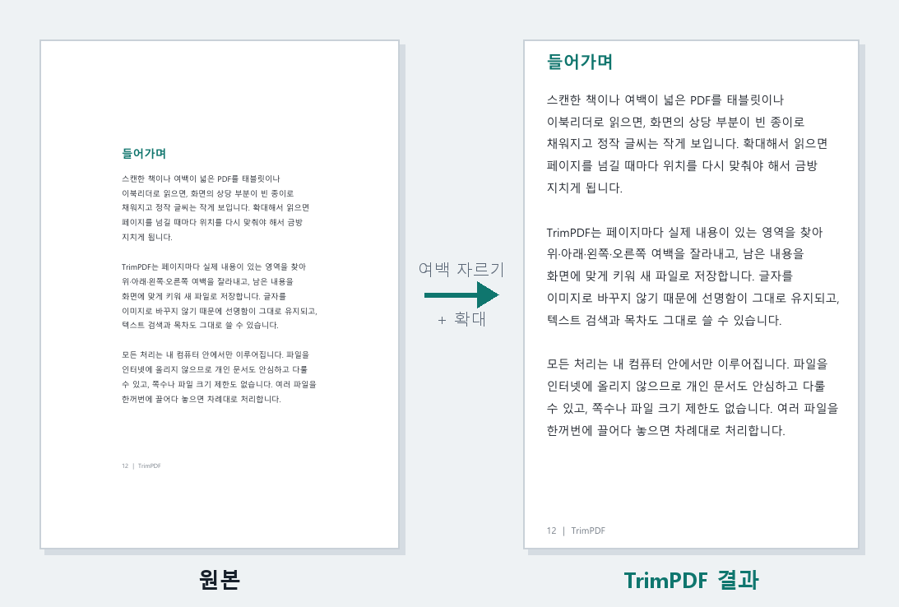
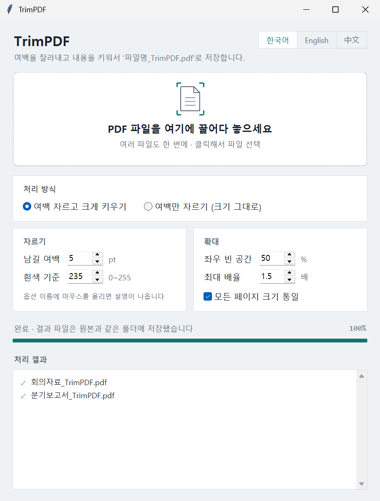
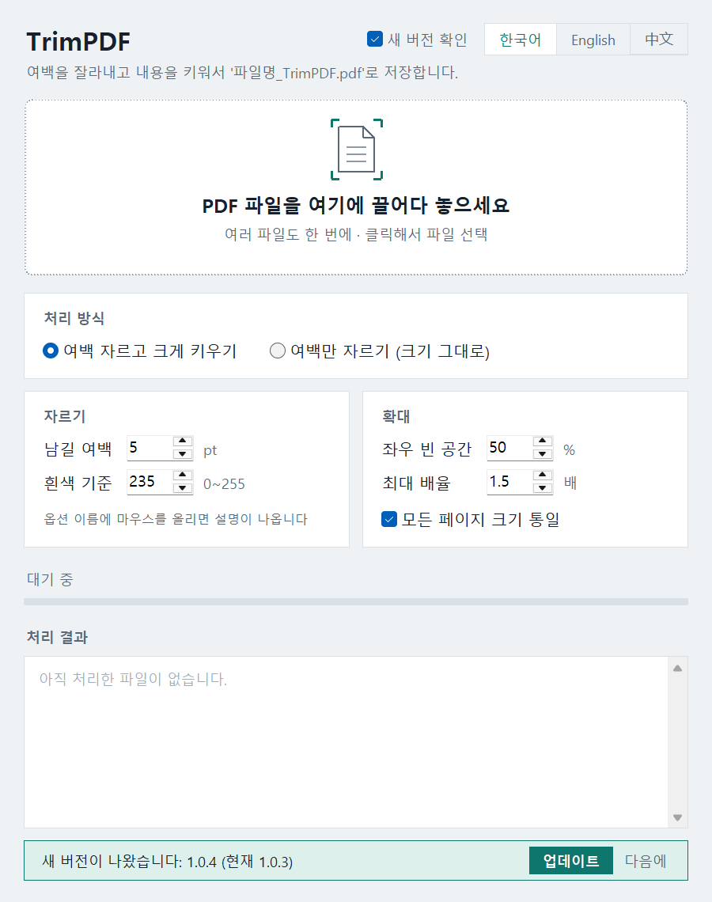
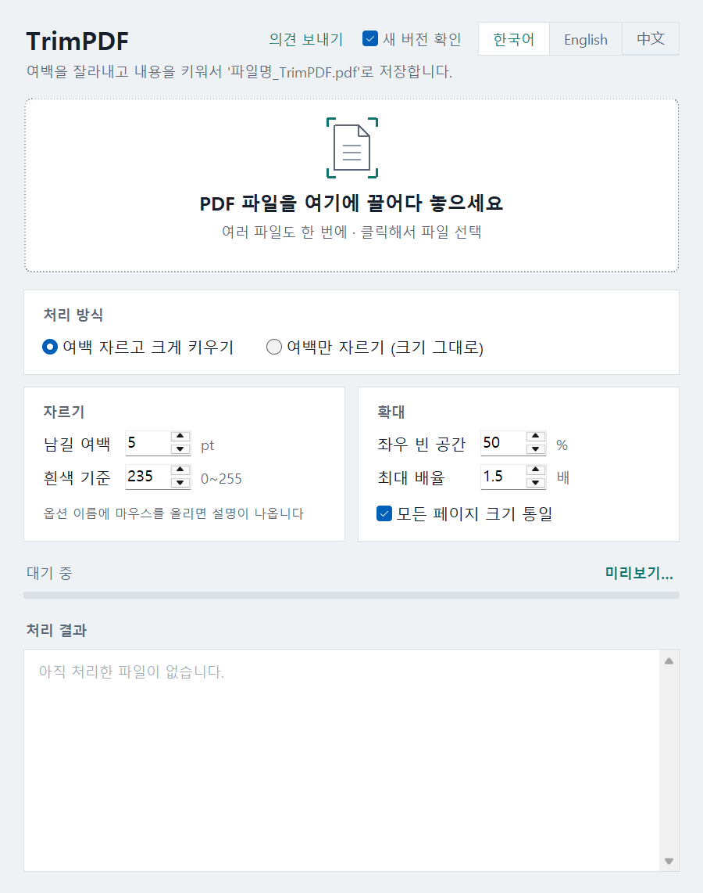

# TrimPDF – Trim PDF margins and enlarge the content

[한국어](README.md) · 中文 / 日本語: see the [user guide](https://microhan1.github.io/TrimPDF/TrimPDF_Manual.html)

A free Windows program for scanned books and wide-margin PDFs. On a tablet or an e-reader half the screen is blank paper and the text is small. Drop a PDF onto the TrimPDF window and it finds the top, bottom, left and right margins on every page, trims them, enlarges what is left and saves a new file. The original is never touched.



## Features

- **One drag**: drop a PDF onto the window or onto the exe icon and it is processed. Several files at once are fine.
- **Original untouched**: the result is written next to it as `name_TrimPDF.pdf`. If that file already exists it is not overwritten; a number is added, as in `name_TrimPDF(2).pdf`.
- **Text stays sharp**: pages are not turned into images, so text selection, search and the table of contents are kept.
- **Scans come out clean**: yellowed paper, dust and the shadow along the edge are ignored; only the real content is found.
- **Comfortable to read**: all pages get the same size, and a page with a single picture is not blown up too much.
- **Preview**: before processing, see page by page what will be cut, marked with a red box. Click **Preview…** to the right of the progress bar.
- **Cancel and open**: while processing, the same spot becomes **Cancel**. When done, click a file name in the result list to open it, or **Show in folder** to see where it was saved.
- **Only on your PC**: files are never uploaded. The one exception is the update check below, which can be turned off. No page or file-size limit.
- Interface in **Korean · English · Chinese (Simplified) · Japanese**. The language follows Windows the first time; change it at the top right and it is remembered.



*Picture: the window with the Korean interface. The English layout is the same.*

## Download and use

1. Get `TrimPDF.exe` from [Releases](https://github.com/microhan1/TrimPDF/releases/latest). Nothing to install.
2. Run it and drop PDF files onto the window.
3. `name_TrimPDF.pdf` appears in the same folder as the original.

> The first time, Windows may show "Windows protected your PC". Choose **More info → Run anyway**. The program is unsigned, which is why the notice appears.

Options and troubleshooting are in the [user guide](https://microhan1.github.io/TrimPDF/TrimPDF_Manual.html#en) (Korean · English · Chinese).

### Main options

| Option | Default | What it does |
|---|---|---|
| Mode | Trim and enlarge | Choose "Trim only (keep size)" to keep the page size |
| Margin to keep | 5 pt | Space left around the detected content (1 pt ≈ 0.35 mm) |
| White level | 235 | Anything darker than this counts as content |
| Side space | 50 % | How much space to leave left and right when the content is narrow |
| Max zoom | 1.5 × | Enlargement limit (0 = no limit) |
| Same size for all pages | On | Keeps the page size from changing as you turn pages |

## Good to know

- Links, notes, comments and form fields in the original are not carried over.
- Password-protected PDFs cannot be processed.
- The program never downloads or replaces itself.
- The language and the update-check setting are stored in `%APPDATA%\TrimPDF\settings.json`.

## Update check

When it starts, TrimPDF sends only the tool name and its version to the Chaekgalpi server (chaekgalpi.co.kr) to see whether a newer version exists. No file is sent, it checks at most once a day, and the **Check for updates** box at the top right turns it off.

If a newer version exists, a one-line notice appears at the bottom of the window. **Update** opens the tool's page on the Chaekgalpi site; **Later** hides that version for good. Without a connection, or if the server does not answer, nothing is shown.



*Picture: the notice line, produced with a fake server answer for the screenshot. Not a real release.*

## Feedback

Click **Send feedback** at the top right, or go to https://chaekgalpi.co.kr/en/tools/trimpdf#feedback — no sign-in needed. [GitHub Issues](https://github.com/microhan1/TrimPDF/issues) work too. The button only opens that page in your browser; the program itself sends nothing.



## Run from source

Python 3.10 or newer.

```bash
pip install -r requirements.txt
python trimpdf.py
```

Build the exe:

```bash
pip install pyinstaller
pyinstaller --noconfirm --onefile --windowed --name TrimPDF --collect-data tkinterdnd2 --collect-binaries tkinterdnd2 trimpdf.py
```

The result is `dist/TrimPDF.exe`.

### How it works

1. Each page is rendered at low resolution to measure the paper brightness; anything clearly darker than the paper is located in cells of about 1 mm.
2. The output page size comes from the scale limit and the side-space ratio. With "same size for all pages" on, the median size is used for every page.
3. The content area of the original page is placed on the new page as PDF content, not as an image. Rotated and landscape pages keep their orientation.

## Related

- Same series: [Two-page Split](https://github.com/microhan1/scan-pdf-split) (split spreads first, then trim) · [Scan PDF Cleanup](https://github.com/microhan1/scan-pdf-cleanup) · [PDF TOC Bookmarks](https://github.com/microhan1/pdf-toc-add)
- All tools, with an English page for each: https://chaekgalpi.co.kr/en/tools
- Finished the book? Log it on [Chaekgalpi Library](https://chaekgalpi.co.kr/en/tools/trimpdf?utm_source=github&utm_medium=referral&utm_campaign=tool_cta&utm_content=trimpdf), a web service for keeping track of the books you read. The tools page is in English; the reading-log service itself is in Korean.

## License

[GNU Affero General Public License v3.0](LICENSE)

TrimPDF uses [PyMuPDF](https://github.com/pymupdf/PyMuPDF), which is AGPL-3.0, so it is released under the same license.

Open-source components: PyMuPDF (AGPL-3.0), NumPy (BSD-3-Clause), tkinterdnd2 (MIT), PyInstaller (GPL-2.0 with bootloader exception)
